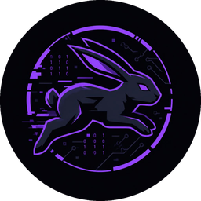
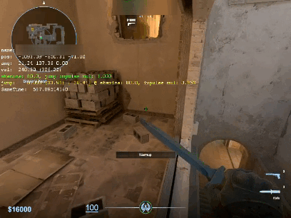

<div align="center">
  
  <h1>CS2 Bhop</h1>
  <p>A C# bunnyhop utility for Counter-Strike 2 with 1ms timer precision.</p>

[](https://github.com/Jesewe/cs2-bhop/releases)
[](https://github.com/Jesewe/cs2-bhop/releases/latest/)
[](LICENSE)

<a href="#overview"><strong>Overview</strong></a> •
<a href="#installation"><strong>Installation</strong></a> •
<a href="#usage"><strong>Usage</strong></a> •
<a href="#troubleshooting"><strong>Troubleshooting</strong></a>

</div>

---

# Overview

CS2 Bhop reads memory from `cs2.exe` to trigger jump commands when you hold space.

<div align="center">
  
</div>

Features:
* **Offset Dumper Integration**: Downloads `cs2-dumper` into `%LOCALAPPDATA%\Requests\ItsJesewe\dumper_output` and reads `buttons.json`, `offsets.json`, and `client_dll.json`.
* **Patch Detection**: Checks the Steam News API on startup to detect game updates and refresh dumper binaries.
* **1ms Precision**: Sets OS timer resolution to 1ms via `winmm.dll` to prevent jump input delays.
* **Focus Check**: Pauses jump inputs automatically when CS2 is not the active window.

---

# Installation

## Requirements

* Windows 10 or 11 (64-bit)
* .NET 8.0 or 9.0 SDK (to build from source)

## Building from Source

1. Clone the repository:
   ```bash
   git clone https://github.com/Jesewe/cs2-bhop.git
   cd cs2-bhop
   ```

2. Build the project:
   ```bash
   dotnet build -c Release
   ```

3. Publish a single-file executable:
   ```bash
   dotnet publish -c Release -r win-x64 --self-contained true /p:PublishSingleFile=true /p:PublishTrimmed=true -o publish
   ```

## Pre-Built Binary

Download the compiled executable from [Releases](https://github.com/Jesewe/cs2-bhop/releases).

---

# Usage

1. Start Counter-Strike 2.
2. Run `cs2-bhop.exe` (as Administrator if required).
3. Hold **SPACE** in-game to bunnyhop. The tool checks player ground flags and sends jump inputs on ground contact.
4. Switching away from CS2 pauses the inputs until you focus the game again.

---

# Troubleshooting

* **cs2-dumper Exited with Code 2**:
  Check that `%LOCALAPPDATA%\Requests\ItsJesewe\` is writable. Ensure paths with spaces are enclosed in quotes.
* **Process Not Found**:
  Verify `cs2.exe` is running. Press **R** in the console to retry scanning.
* **Loss of Speed While Hopping**:
  Ensure your system permits multimedia timer resolution changes via `winmm.dll`.

---

# License

GNU General Public License v3.0. See [LICENSE](LICENSE) for details.
